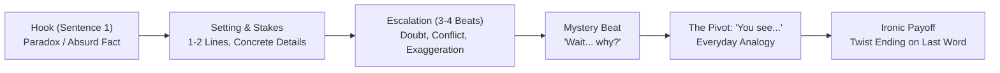
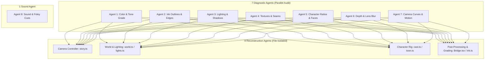

# The Viral Animated Shorts Workflow Bible
> Reverse-Engineered from Top Channels (Celyxi, Comicron) & the Mr. Omi / Claude 3D-in-Code Pipeline

---

## 1. Executive Summary & Core Philosophy

This document details the exact formula and engineering pipeline behind viral vertical animated Shorts (60–75s, 1080×1920 at 30 fps) that generate hundreds of millions of views. 

### Why These Videos Go Viral
1. **Not AI Slop**: They are not generated by generic AI video generators (Runway, Sora, Pika). They are rendered in real 3D code (**Three.js inside Remotion**) on local machines with deterministic control over every frame, camera curve, light, shadow, and caption.
2. **Emotional Storytelling Over Plain Narration**: They don't lecture like Wikipedia. They open with an absurd human paradox, escalate conflict, create dramatic mystery, pivot with an everyday analogy, and drop an ironic punchline.
3. **The "Hybrid 2D/3D" Visual Magic**: Flat, highly expressive 2D cartoon/stickman characters placed inside physically lit 3D toon environments. The characters catch scene keylights, cast real ground shadows, and the world features comic-book black ink outlines with cinematic tilt-shift lens blur.
4. **Camera Continuity**: Almost zero hard cuts. The camera glides seamlessly through the 3D world, following actions and flying through doors/windows.

---

## 2. Layer 1: Script Engineering & Story Formula (100% of Top Videos Follow This)

Top channels like **Celyxi** (the owner's channel: Prison, Sailors' Noses, Pharaoh) and **Comicron** (Winemakers) follow an identical psychological narrative structure:

### The 6-Beat Script Formula
1. **The Hook (Frame 1 to 4, Sentence 1, No Intro/Logo)**:
   - An absurd paradox stated deadpan as absolute fact.
   - Examples:
     - *"They buried a man alive with a bell tied to his finger."*
     - *"A pharaoh gave his daughter to a thief who stole from him."*
     - *"Why winemakers never fill the bottle to the top."*
     - *"Seventy-four soldiers knocked down an iron bridge just by walking across it."*
   - Length: 10–16 words. Viewer cannot scroll away without knowing *why*.
2. **Setting & Stakes (1–2 sentences)**:
   - Present tense, concrete details (year, named everyman, numbers, locations).
3. **Escalation (3–4 beats)**:
   - Conflict ramps up. Characters laugh, doubt, mock, or panic.
   - Dialogue is punchy and short. Exaggeration humor ("so slow that...").
4. **The Mystery Beat**:
   - A sudden question or hesitation: *"Wait, how could that be?"* or *"But then something unexpected happened."*
5. **The Signature Pivot ("You see...")**:
   - Used in **14 out of 20 viral shorts**.
   - The narrator transitions from mystery to the hidden mechanism: logic that makes sense inside the story's world (or the real physics,
     psychology or history when the story is true; made-up stories are the default, see `CLAUDE.md`).
   - Explains the mechanism via an **everyday analogy** (*"Think about the last time you..."*, *"Imagine pushing a kid on a swing..."*).
6. **Ironic Payoff / Loop Callback**:
   - The short ends abruptly on the punchline or twist, with zero outro or "subscribe" begging.
   - Often loops smoothly back into the first sentence.

### Voice & Delivery Metrics
- **Cadence**: Fast, relentless delivery: **3.5 to 4.1 words per second** (median **3.7 words/s**).
- **Dead Air**: Almost zero pauses. Word gaps >0.25s must not exceed 1.0s across the entire 60s video.
- **Audio Mix**: Voice integrated at **-14 LUFS** (heavily compressed, LRA ~2.4 LU). Music bed sits at **-22 dB to -26 dB** under speech. Sound effects duck speech slightly on impacts.

---

## 3. Layer 2: 3D Visual Construction & Shading

The secret to why most reproductions look cheap (and why these look like high-budget cinema) lies in **micro-details measured at 30 fps**:

| Element | Amateur / Cheap AI Attempt | Celyxi / Comicron Proven Look |
| :--- | :--- | :--- |
| **Characters** | Perfectly round circle heads, chunky bodies, clipart-like | Bean/egg heads (h/w ratio ~0.94), thin expressive stick limbs, drawn-on expressive faces |
| **World Geometry** | Generic 3D models or AI hallucinations | Low-poly 3D geometry with hand-painted HD Canvas2D procedural textures, visible dark seams |
| **Ink Outlines** | Missing, or blurred out by post-filters | 3–5px crisp black ink outlines (#030303) on 3D geometry edges & creases, rendered via custom post-pass |
| **Lighting** | Flat ambient lighting | Warm golden/noon keylight + cool blue/purple shadows; characters receive scene light & cast ground shadows |
| **Depth of Field** | Sharp everywhere | Tilt-shift lens blur: background heavily blurred (cInf 12–16px), character eyes razor-sharp |
| **Camera Movement** | Snappy cuts or static shots | Continuous glides (65% of frames moving); ease-out bursts over 20–25 frames; 0–1 hard cuts per video |
| **Color Grade** | Muddy darks or oversaturated neon | Saturated sky/highlights, no pure black in shadows; warm highlights + deep violet night-blue during "You see..." |

### Key Shaders in Three.js / Remotion
1. **Edge-Detection Ink Shader (`ink.ts`)**:
   - Sobel/depth-normal convolution pass detecting geometry discontinuities.
   - Width: 5.1px in foreground (6m) scaling to 3.3px in background (90m).
   - Character billboards are placed on `NOINK` render layers (they carry their own plum-colored vector outlines).
2. **Lens Blur / Tilt-Shift (`lensblur.ts`)**:
   - Hexagonal bokeh disc blur with depth-map weighting.
   - Keeps viewer focus locked strictly on character facial reactions.
3. **Lighting Setup (`lights.ts`)**:
   - **Day Preset**: Sun elevation 48°, azimuth 75°. Keylight `[1.58, 1.50, 1.33]`, ambient fill `[0.30, 0.29, 0.36]` (cool blue).
   - **Golden / Evening Preset**: Sun elevation 7°, azimuth 6° (low backlit sun). Key `#FFB36B`, violet shadows `#444380`.

---

## 4. Layer 3: The Multi-Agent Verification Architecture

When using Claude to build or audit animated Shorts, follow the **12-Agent Studio Model**:

### The Golden Rule of Multi-Agent Coding
> **"Don't just split jobs — split files."**
> Each reconstruction agent must strictly own its own dedicated files (`story.ts`, `world.ts`, `toon.ts`, etc.) to prevent git merge conflicts and regression loops.
> **"Don't ask Claude for an opinion — make it measure."**
> Always calculate exact numbers: luminance standard deviation, edge pixel counts, phase-correlation camera drift, and head-to-body height ratios.

---

## 5. Reference Videos Stored in this Repository

| Index | File Name | Channel / Style | Story & Key Mechanics |
| :---: | :--- | :--- | :--- |
| **1** | `1_sailors_noses.mp4` | **Celyxi** (Owner's channel - 2D outlined) | Scurvy / maritime history: pacing, character faces, physical props |
| **2** | `2_roller_coaster.mp4` | **Ricks Clips** (2D in 3D) | High-speed rollercoaster physics: camera tilt, whip pans, impact shakes |
| **3** | `3_prison_LIKED.mp4` | **Celyxi** (Owner's channel - 3D toon world) | Prison escape / emotional stakes: rich lighting, low-angle camera, suspense |
| **4** | `4_comicron_stickman.mp4` | **Comicron** (Stickman 3D) | Winemaker bottle void: comedic pacing, fluid stickman gestures, curiosity hook |
| **5** | `5_celyxi_pharaoh_thief.mp4` | **Celyxi** (Owner's channel - Cinematic Epic) | Ancient Egypt heist: emotional dialogue, dramatic lighting shifts, masterclass camera glide; narrator voice source |

All reference videos in `inbox/reference_shorts/` are for private study and metric extraction only.
